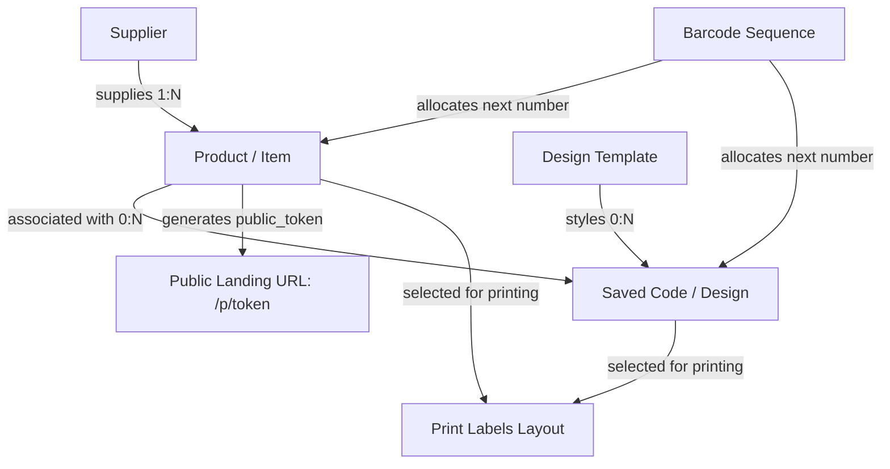

# Barcode & QR Code Studio — Technical Specification & Project Documentation

> Read this file fully before writing any code. Follow it as the single source of truth. If something is unclear, make the simplest reasonable choice and note it in `docs/DECISIONS.md`. When the documentation and the real code disagree, the code wins.

---

## Table of Contents
1. [Existing Setup & Tech Stack](#1-existing-setup--tech-stack)
2. [Status and Roadmap](#2-status-and-roadmap)
   - [2.1 Implemented Features](#21-implemented-features)
   - [2.2 Planned — Not Built Yet (Roadmap)](#22-planned--not-built-yet-roadmap)
   - [2.3 Described but NOT in the Code](#23-described-but-not-in-the-code)
   - [2.4 Known Limitations](#24-known-limitations)
   - [2.5 Customer UX Principles](#25-customer-ux-principles)
3. [Architecture: How Things Connect & Glossary](#3-architecture-how-things-connect--glossary)
   - [3.1 Entity Relationship Flow](#31-entity-relationship-flow)
   - [3.2 Glossary](#32-glossary)
4. [Detailed Feature Specifications](#4-detailed-feature-specifications)
   - [4.1 Gallery (`/`)](#41-gallery-)
   - [4.2 Designer (`/designer` and `/designer/:id`)](#42-designer-designer-and-designerid)
   - [4.3 Inventory Management](#43-inventory-management)
     - [4.3.1 Items (`/products/items`)](#431-items-productsitems)
     - [4.3.2 Bulk Generate Codes (`POST /api/codes/bulk`)](#432-bulk-generate-codes-post-apicodesbulk)
     - [4.3.3 Suppliers (`/products/suppliers`)](#433-suppliers-productssuppliers)
   - [4.4 Print Labels (`/print`)](#44-print-labels-print)
   - [4.5 Recycle Bin (`/bin`)](#45-recycle-bin-bin)
   - [4.6 Design Templates (Template Manager)](#46-design-templates-template-manager)
   - [4.7 Public Product Page (`/p/:token`)](#47-public-product-page-ptoken)
5. [Barcode Generator & Storage Matrix](#5-barcode-generator--storage-matrix)
   - [5.1 Sequential Barcode Number Generator](#51-sequential-barcode-number-generator)
   - [5.2 Storage Matrix: Where Settings Live](#52-storage-matrix-where-settings-live)
6. [Complete Route Map](#6-complete-route-map)
   - [6.1 Frontend SPA Routes & Legacy Redirects](#61-frontend-spa-routes--legacy-redirects)
   - [6.2 Backend API Routes (57 Endpoints)](#62-backend-api-routes-57-endpoints)
7. [Database Schema](#7-database-schema)
8. [UI / UX Design System](#8-ui--ux-design-system)
9. [Frontend Folder Structure](#9-frontend-folder-structure)
10. [Definition of Done](#10-definition-of-done)
11. [Working Rules for the Agent](#11-working-rules-for-the-agent)

---

## 1. Existing Setup & Tech Stack

Laravel and React (Vite) are **already installed** in this directory as a single unified project.
- Do **NOT** re-create the Laravel project or re-scaffold React/Vite. Do not run `composer create-project` or `npm create vite`.
- One Blade view (`resources/views/app.blade.php`) mounts the React SPA; a catch-all web route in `routes/web.php` serves it for every non-API URL.
- React calls the API at the relative path `/api` (same origin, no CORS setup needed).

### Stack & Packages
- **Backend:** Laravel 11 (PHP 8.2+), REST JSON API (`routes/api.php`).
- **Database:** MySQL configured in `.env` (`DB_CONNECTION=mysql`, `DB_DATABASE=barcode_designer`), SQLite in `.env.example`.
- **Frontend SPA:** React 19 (`react: ^19.3.1`, `react-dom: ^19.3.1`), React Router v7 (`react-router-dom: ^7.18.4`).
- **Asset Bundler:** Vite 8 (`vite: ^8.0.0`) with `@vitejs/plugin-react: ^6.1.2` and `laravel-vite-plugin: ^3.1`.
- **Styling:** Tailwind CSS v4 (`tailwindcss: ^4.0.0`, `@tailwindcss/vite: ^4.0.0`).
- **Icons:** Lucide React (`lucide-react: ^1.61.0`).
- **Barcode & QR Libraries:**
  - `jsbarcode` (`^3.12.3`) — SVG-based 1D barcode rendering.
  - `qr-code-styling` (`^1.9.2`) — Canvas and SVG 2D QR rendering with custom dot styles, corner shapes, error correction, and logo embedding.
  - `html-to-image` (`^1.11.13`) — DOM-to-PNG image snapshot capture for thumbnails and downloads.
  - `jspdf` (`^4.2.1`) — Vectorized sheet PDF export for label sheets.
- **Data Fetching:** `axios` (`^1.20.0`) + `@tanstack/react-query` (`^5.104.5`).
- **Notifications:** `react-hot-toast` (`^2.6.1`).

### Local Development Commands
Run locally with two background processes:
- Terminal 1: `php artisan serve` (serves at `http://localhost:8000`)
- Terminal 2: `npm run dev` (Vite dev server)

---

## 2. Status and Roadmap

### 2.1 Implemented Features
- [x] **Label Designer:** Split-pane studio with independent scrolling, real-time SVG preview, floating zoom widget (25%–400%, fit, pan), interactive code dragging and repositioning, code-vs-artboard sizing with unit switch (`mm`, `cm`, `inch`, `px`), multi-line customizable label text with placeholder insertion (`{name}`, `{sku}`, `{price}`, etc.), and collapsed Advanced accordion groups.
- [x] **1D & 2D Symbologies:** CODE128, EAN-13, EAN-8, UPC-A, CODE39, ITF-14, Pharmacode, and QR Code (with dot styles, corner styles, error correction L/M/Q/H, and logo uploads).
- [x] **Product Association & Autocomplete:** Link designs to inventory products; dynamically preview item data (`{name}`, `{sku}`, `{price}`, `{category}`, `{supplier}`).
- [x] **Design Gallery:** Filterable grid/list view of saved designs with search, format filtering, batch filtering, direct download, duplication, editing, and soft-delete.
- [x] **Inventory Items Management:** `table-fixed` responsive data table displaying product name and Item Code merged in the primary column, category, supplier, price, stock status, selected-only CSV export, CSV import with field mapping and validation dry run, and Add/Edit modals with inline sequential barcode generation.
- [x] **Bulk Code Generation:** 3-step modal wizard generating up to 500 codes in a run, with template selection, pattern configuration, live preview, in-browser SVG rendering, and batch saving to `POST /api/codes/bulk`.
- [x] **Suppliers Directory:** Full CRUD supplier directory with contact details (mobile, phone, email, address, city, country, website, payment terms), view drawer with linked products list, and selected-only CSV export.
- [x] **Sequential Barcode Generator:** Collision-free sequential barcode generation with checksum computation for EAN-13, EAN-8, UPC-A, and CODE-128 using database-locked sequence counters (`barcode_sequences`).
- [x] **Sheet Print Studio:** Multi-item grid layout generator with paper size configuration (A4, Letter, A3, A5, A6, Legal, 4x6, Custom), label sheet presets, custom margins and gaps, fit modes, PDF export via `jspdf`, custom reusable presets (`print_presets`), and `@media print` browser output.
- [x] **Unified Recycle Bin:** Centralized soft-delete recovery hub at `/bin` for Items, Suppliers, and Saved Designs with 30-day retention countdown, individual restore, permanent delete, restore-all, and empty bin actions.
- [x] **Design Templates:** System and user design templates managed via a full-featured Template Manager modal (create, apply, rename, duplicate, set default, delete).
- [x] **Public Product Landing Page:** Mobile-friendly public product verification page at `/p/{token}` generated from QR code links.

### 2.2 Planned — Not Built Yet (Roadmap)
> [!IMPORTANT]
> The following features are planned for future iterations. Do NOT assume they exist in the code:

1. **Quick Print Wizard (NOT BUILT):**
   - Customer-facing 4-step wizard designed for quick, non-technical label printing:
     - **Step 1 (Choose items):** Quick search and selection from inventory with quantity multipliers.
     - **Step 2 (Label style):** Pick from visual starter styles (Shelf tag, Small label, Box label, Simple QR).
     - **Step 3 (Paper setup):** Select paper (A4, Letter, 4x6 thermal roll, or Custom) and sheet grid.
     - **Step 4 (Print):** Instant sheet preview with copies calculation and one-click print or PDF download.
   - Will serve as the root landing page (`/`), with the current Gallery moved to "My designs" (`/designs`) and simplified sidebar navigation.
2. **User Authentication & Roles (NOT BUILT):** User registration, login, password recovery, session/token guards, and roles (`admin` vs `customer`). All current `/api/*` routes are unauthenticated.
3. **Dedicated Settings Page (NOT BUILT):** System configuration UI for default currency, default measurement units, default paper size, barcode prefix, and recycle bin retention periods.
4. **Theme / Dark Mode (NOT BUILT):** System, light, and dark mode theme switching with user preference persistence. Currently, light theme only.
5. **Bulk Update QR Links Tool (NOT BUILT):** Batch migration tool to rewrite existing QR code URLs when changing domain or moving from local testing (`localhost`) to production `APP_URL`.
6. **Automated Testing & QA Suite (NOT BUILT):** End-to-end browser testing (Playwright or Cypress) and comprehensive frontend unit tests.
7. **Production Deployment Packaging (NOT BUILT):** Dockerfiles, CI/CD automated deployment pipelines, and production asset optimization.

### 2.3 Described but NOT in the Code
The following items were mentioned in previous documents or requests, but inspection of the codebase confirms they do **not** exist in the code:

| Feature / Detail | Old Document Claim | Real Code Reality |
| :--- | :--- | :--- |
| **Recycle Bin Button in Headers** | Claimed Gallery, Items, and Suppliers headers have a "Recycle Bin" button with count badge. | **NOT in code.** The Recycle Bin button was removed from all page headers; it is accessible exclusively via the sidebar navigation (`/bin`). |
| **Active `settings` Table Keys** | Claimed `public_page_enabled` and `public_page_show_supplier` in the `settings` table toggle public product page visibility and supplier info. | **NOT in code.** The `settings` table was seeded by migration, but no controller (`PublicProductController`, `ProductController`) reads it, no `/api/settings` route exists, and the public page is unconditionally active with supplier details always visible. |
| **Dark Mode on Public Page** | Claimed public product page supports light and dark modes according to system/app theme. | **NOT in code.** No dark mode styles, theme tokens, or toggle switches exist. Standard light theme is rendered. |
| **Auto-Purge for Trashed Suppliers** | Claimed automatic 30-day purge exists for all entities. | **NOT in code.** In `routes/console.php`, only `products:purge-trash` (`PurgeTrashProducts.php`) and `codes:purge-trash` (`PurgeTrashCodes.php`) are scheduled. There is no `PurgeTrashSuppliers` command or supplier purge schedule. |

### 2.4 Known Limitations
- **QR Links Require Publicly Accessible `APP_URL`:** QR codes embedding product links encode `{APP_URL}/p/{token}`. If `APP_URL` is set to `localhost`, external mobile phones scanning the printed label cannot resolve the URL unless on the same local network or mapped to a public domain/tunnel.
- **Public Product Page Exposure:** Supplier details and basic item attributes are directly visible on `/p/{token}`. Granular field visibility toggles were removed from active controllers.
- **Single-User / Local Context:** Currently operates in single-tenant mode without authentication barriers.
- **Light Theme Only:** Dark mode color tokens are planned; do not display broken dark toggle switches.

### 2.5 Customer UX Principles
The target users are store owners, inventory clerks, and small business operators:
- Maintain plain, human-friendly terminology: use **Item Code** instead of raw developer terms like `sku`.
- Primary actions (Print, Save, Download) must be visible without scrolling or hunting through nested menus.
- Avoid cluttered interfaces: default view exposes essential controls; advanced styling lives in collapsible accordions.

---

## 3. Architecture: How Things Connect & Glossary

### 3.1 Entity Relationship Flow


1. **Supplier → Product:** Each product optionally belongs to a Supplier (`products.supplier_id` foreign key referencing `suppliers.id`).
2. **Product → Codes:** A saved label design in the `codes` table can reference a product (`codes.product_id`). When linked, code values and labels can dynamically bind to product data.
3. **Template → Codes:** Reusable label styling templates in `templates` seed design parameters for new or existing records in `codes` (`codes.template_id`).
4. **Codes / Products → Print Studio:** Users send individual designs or inventory items to `/print?code_ids=...` or `/print?product_ids=...` to compile batches onto printable sheets.
5. **Public Token → QR Code:** Every product has a unique `public_token`. When creating a QR code, setting the value to `{public_url}` encodes `APP_URL/p/{public_token}`.

### 3.2 Glossary
- **Item Code:** The customer-facing identifier for an inventory product. In the database schema and API payloads, the field is named `sku`, with `{sku}` retained as an alias for `{item_code}`.
- **Artboard:** The physical label canvas (dimensions, borders, corner radius, padding, background color) on which the code and text sit.
- **Code Size:** The physical width and height of the raw barcode or QR matrix itself, independent of the surrounding artboard canvas.
- **Template:** A reusable styling configuration (dimensions, color palette, font sizing, alignment, barcode format) that can be applied to any label without an encoded value.
- **Placeholder:** A dynamic token in label text (e.g., `{name}`, `{item_code}`, `{price}`, `{public_url}`) replaced at render time with the corresponding product attribute.
- **Batch:** A bulk generation run grouping multiple generated codes under a single `batch_id` (UUID) in the `codes` table.
- **Preset:** A saved physical sheet configuration in Print Labels (paper size, margin offsets, row/column counts, cell gaps).

---

## 4. Detailed Feature Specifications

### 4.1 Gallery (`/`)
- **Default Route:** Serves as the start page cataloging all saved designs.
- **Card Grid:** Responsive card grid (1 / 2 / 3 / 4 columns) with preview centered on neutral light gray canvas (`#F4F4F5` / `bg-zinc-100`).
- **Preview Thumbnail Display:** Previews are displayed using `object-contain` centered with a small padding (`p-3`) on the `#F4F4F5` background. Never uses `object-cover` or fixed heights that crop. Card size remains consistent regardless of aspect ratio.
- **Card Details:** Name, type badge (Barcode / QR), format, created date, and actions (Edit, Download PNG, Print, Delete). Displays a small `"Template: <name>"` line if created from a template, and a subtle batch label for codes generated in bulk.
- **Toolbar & Batch Rebuild Previews:** Search box, format filters (All / Barcode / QR / Last bulk run), `+ New Design` primary button, and **"Rebuild previews"** action. The Rebuild Previews tool regenerates preview images of selected or all saved codes from their saved settings in sequential batches with a real-time progress indicator and a Cancel button, then refreshes the Gallery.
- **Delete Confirmation:** Soft-deletes code to the Recycle Bin with undo toast notification.

### 4.2 Designer (`/designer` and `/designer/:id`)
- **Two-Pane Independent Layout:**
  - **Left Pane (~65–70% width):** Real-time interactive artboard preview fixed in place.
  - **Right Pane (~30–35% width, clamped 340–440px):** Independent vertical scrolling (`overscroll-behavior: contain`), displaying essential controls by default.
  - At 1024px and above, the outer page body does not scroll (`height: calc(100dvh - <header>)` with `overflow: hidden`). Below 1024px, preview is sticky at top (max 40vh) with controls underneath.
- **Preview Pane (Left):**
  - **Artboard Canvas:** Centered live SVG rendering reflecting exact dimensions, colors, margins, label color, and typography.
  - **Interactive Canvas Direct Manipulation:**
    - Click & drag code on the artboard to position it freely; double-click code to reset offsets.
    - Click label text directly in the preview to focus and edit the field.
    - Thin selection outline on hover.
  - **Floating Zoom Widget:** Fixed zoom steps (`25%`, `50%`, `75%`, `100%`, `150%`, `200%`, `300%`, `400%`), clickable percentage dropdown, and `Fit` button with auto re-fit on resize. Supports `Ctrl` + mouse wheel zoom, touchscreen pinch zoom, and keyboard shortcuts (`+`, `-`, `0` for Fit). Canvas drag-to-pan when zoomed in beyond viewport.
  - **Floating Artboard Size Chip:** Displays physical dimensions (e.g. `50 × 25 mm`).
  - **Single Status Line:** Replaces scattered warnings with one concise line under preview: green dot + `"Ready to scan"` when valid, or single amber message with an auto-action `"Fix"` button (e.g., auto-fix check digit, or low contrast fix for label color).
  - **Action Footer:**
    - Primary `Save` button with status text ("Saved" / "Unsaved changes"). Saving automatically re-renders a fresh, uncropped preview image.
    - `Download` button with popover: **PNG** and **SVG** with embedded DPI selector (72, 150, 300; defaults to 300).
    - More actions (`...`) menu: Reset, Duplicate as new, and Export code only toggle.
- **Shared Off-Screen Preview Rendering:**
  - Every saved preview (Designer Save, Bulk Generate, Template Thumbnails, and Rebuild Previews) is generated via ONE shared rendering engine that draws the complete artboard (code, label text with `labelColor`, background, border, padding) at its real physical size in an off-screen, unscaled container (completely isolated from zoom, pan, pane overflow, or "Export code only" toggles).
  - Awaits font loading (`document.fonts.ready`) and asynchronous QR rendering before capturing at a sensible 2x pixel ratio (capped at ~1200px on the longest dimension). Always includes the complete label text.
- **Editor Controls (Right Pane):**
  - **Top Row:** Mode switch (**Barcode | QR Code**), followed by a row containing a **Template** dropdown and a **Product** picker.
  - **Design Group (Always Visible):**
    - **Value:** Text input with inline **Generate** wand button (sequential barcode number generator) and "Link to product page" toggle in QR mode.
    - **Format:** Barcode format selector (`CODE128`, `EAN13`, `EAN8`, `UPC`, `CODE39`, `ITF14`) or QR error correction level.
    - **Label Text:** Text input with an **Insert** placeholder popover menu (`{name}`, `{item_code}`, `{price}`, `{category}`, `{supplier}`, `{public_url}`) with live sample values. Auto-fills from selected product if empty.
    - **Quick Size & Gap Row:** Directly beneath label text: font size (pt with `-`/`+` buttons) and gap (with `-`/`+` buttons), synced with Advanced text settings.
    - **Size (Code Dimensions):**
      - **Unit Switch:** Segmented control (`mm`, `cm`, `inch`, `px`) on the right of the Size title row. Globally controls all spatial input fields.
      - **Code Size Chips:** Barcode presets (`Small 30×10 mm`, `Medium 45×15 mm`, `Large 60×20 mm`), QR presets (`Small 15 mm`, `Medium 25 mm`, `Large 40 mm`), `Auto`, and `Custom`.
    - **Artboard Sizing:** Select dropdown: `Fit to code`, `Small label (50 × 25 mm)`, `Shelf label (60 × 40 mm)`, `Product label (100 × 50 mm)`, `Shipping label (100 × 150 mm)`, `Square (50 × 50 mm)`, `A6`, `A5`, `A4`, `Business card (90 × 55 mm)`, and `Custom`.
    - **Colors:** Code foreground and background color swatches with hex pickers and a **Swap** icon button.
    - **Label Color Control:** Positioned directly below the Colors row. Contains a single color swatch with compact picker and hex input, plus a "Match code color" shortcut button. Governs label text color (and barcode human-readable text). Defaults to code color for new designs and backward-compatible fallbacks for legacy designs. A gentle warning appears in the status line if contrast against the background is insufficient, with a one-click "Fix" action.
  - **Advanced Settings (Vertical Accordion):**
    - Single-open accordion containing collapsible panels with chevron indicators:
      1. **Artboard Style:** Card border (toggle, color, width), corner radius, and background color.
      2. **Placement:** 3x3 alignment grid, padding, fit mode (`original`, `fit`, `fill-width`), fine X/Y offsets, reset position.
      3. **Code Style:** Bar width multiplier, margin, show-number toggle; QR error correction (L/M/Q/H), dot style (`square`, `dots`, `rounded`, `extra-rounded`, `classy`), corner style (`square`, `dot`, `extra-rounded`), and logo file upload.
      4. **Text Style:** Font size, font family, gap, font weight (Regular/Bold), text alignment (Left/Center/Right), and **Label Color** picker (synchronized in real time with the Design group control).
      5. **Export:** Export DPI (`72`, `150`, `300`, `600`), lock aspect ratio, "Export code only" checkbox.
    - "Reset advanced settings" button to restore defaults.

### 4.3 Inventory Management

#### 4.3.1 Items (`/products/items`)
- **Table Density & Layout:** Compact rows (40–44px height), 1px dividers, subtle hover, zero horizontal scrollbar.
- **Fixed Column Widths (`table-fixed`):**
  - Checkbox: `36px`
  - **Product (`min-w-[220px]`, 28–30% share):** Displays Product Name in `font-medium` (wrapped up to 2 lines with tooltip) and **Item Code** immediately underneath in muted monospace text. Sorts by Name.
  - Barcode: `120px` (`hidden lg:table-cell`)
  - Category: `110px` (`hidden xl:table-cell`, truncated with tooltip)
  - Supplier: `130px` (`hidden lg:table-cell`, truncated with tooltip)
  - Price: `88px`
  - Qty: `56px`
  - Status: `100px` (semantic status dot + plain text: In Stock, Low Stock, Out of Stock)
  - Actions: `108px` (Generate Code, Edit, Delete)
- **Selection & Bulk Actions:**
  - Row checkboxes, "Select all on page", and "Select all {N} products across all pages" banner.
  - Selection toolbar: Selected count, "Clear selection", **Generate codes** (opens 3-step bulk wizard), and **Export** (exports selected items only).
- **Header Actions on ONE Row:**
  - Order: **Import** (secondary), **Export** (secondary), **Generate codes** (active when items selected), **+ Add Item** (primary). *(Note: No Recycle Bin button in header).*
- **Add / Edit Item Modal:**
  - Two-column grid on desktop, single column on mobile. Fixed header, scrollable body, fixed footer.
  - Fields: Product Name, Item Code (with inline "Generate" Wand button), Barcode Number (with inline "Generate" button), Category, Supplier searchable dropdown, Price, Quantity, Low stock threshold, Description.
  - Inline validation, Escape to close, unsaved changes confirmation.
- **CSV Export & Import:**
  - **Export (`POST /api/products/export`):** Exports selected products as CSV with UTF-8 BOM, standard headers (`name, item_code, barcode_number, category, supplier, price, quantity, low_stock_threshold, description`), and date-based filename.
  - **Import 3-Step Modal:** File upload (drag & drop), column mapping (accepts `item_code` or legacy `sku`), validation dry run with color badges (`New`, `Update`, `Error`), and commit modes ("Skip existing" / "Update existing", "Create missing suppliers", "Auto-generate missing barcodes").

#### 4.3.2 Bulk Generate Codes (`POST /api/codes/bulk`)
- Opened from Items page selection toolbar when items are selected (supports up to 500 items).
- **Step 1 (Settings):** Template selection, value source (`barcode_number` or Item Code `sku`), label text pattern override, missing barcode action (generate, use Item Code, skip), invalid format auto-fix, existing code resolution (create another, replace, skip), and naming pattern.
- **Step 2 (Preview):** Compact table, live SVG thumbnails of first 3 items, summary counters, filter for problems only, validation gate.
- **Step 3 (Generate):** In-browser rendering matching Designer canvas, batch upload in chunks of 25 to `POST /api/codes/bulk`, progress bar, cancel, retry failed, and results screen with shortcuts to View in Gallery or Print Labels. Grouped under a generated `batch_id`.

#### 4.3.3 Suppliers (`/products/suppliers`)
- **Summary Cards:** Total Suppliers, Active Suppliers, Products without a Supplier (compact padding 12–14px, 12px gap).
- **Table Columns:** Name (with contact person under it), Mobile, Email, City, Products (count badge linking to `/products/items?supplier_id={id}`), Status (Active / Inactive dot + text), Actions.
- **Add / Edit Supplier Modal:** Name (required, unique), Contact person, Mobile number (required), Phone number, Email, Address line 1, Address line 2, City, Postal code, Country (default "Sri Lanka"), Website, Payment terms, Notes, Status (`active` / `inactive`).
- **View Supplier Drawer / Modal:** Clean modal with tap-to-call (`tel:`), email (`mailto:`), Google Maps address link, payment terms, website, notes, and a compact list of linked products with Item Codes.
- **Actions:** Selected-only CSV export (`POST /api/suppliers/export`), Add Supplier, Edit, and Delete (soft-deletes to Recycle Bin with linked products safety note).

### 4.4 Print Labels (`/print`)
- **Two-Pane Layout:** Live paper sheet preview on the LEFT (~65–70% width, fixed in place) and settings on the RIGHT (~30–35% width, clamped 340–440px, scrolls independently). Zero horizontal scroll.
- **Choose What to Print:**
  - Multi-select list of saved designs from Gallery with search, preview thumbnails, and format filter.
  - Copies per code selector (default 1) with "Set all to N" batch shortcut.
  - Query parameter integration: pre-fills queue via `/print?code_ids=1,2,3` or `/print?product_ids=4,5`.
- **Sheet Configuration:**
  - **Paper Sizes:** `A4` (210×297 mm, default), `Letter` (215.9×279.4 mm), `A3`, `A5`, `A6`, `Legal`, `4x6` (shipping label roll), and `Custom` (width & height with orientation toggle).
  - **Standard Sheet Presets:** `3x8` (63.5×33.9 mm), `2x7` (99.1×38.1 mm), `4x12` (48.5×25.4 mm), `5x13` (38.1×21.2 mm), and `Custom`.
  - **"Match my design size" Auto-Grid:** When selected designs share identical dimensions, automatically calculates fitting columns and rows for the paper size, margins, and gaps.
  - **Custom Dimensions:** Label width/height, columns, rows, margins (top/left), gaps (horizontal/vertical), and corner radius.
  - **Start Position:** Select which cell on the sheet to start printing from (skips used labels on partly used sheets).
- **Placement & Fitting inside Label Cell:**
  - Fit modes: `Original size`, `Fit to label` (default: scales down preserving aspect ratio), `Fill label`.
  - Toggle artboard background color and border on/off during print.
  - Fits the entire artboard inside the label cell with its padding so nothing is cut off and label text is always visible.
- **Output & Render Engines:**
  - **Direct Dynamic Rendering:** Each label cell is rendered directly from its saved design settings (`codes.settings`) at print and PDF time using the shared render function (vector SVG or high-resolution off-screen render), using the stored preview thumbnail only as a fallback. The live preview on screen, browser `@media print`, and PDF document match identically.
  - **Browser Print:** `@media print` with exact `@page` paper size, 0 margins, and browser UI suppression.
  - **Download PDF:** Vectorized/high-resolution PDF generation via `jspdf` at 300 DPI matching the exact sheet layout.
  - **Presets:** Save and manage custom sheet configurations in `print_presets` table (`GET`, `POST`, `DELETE /api/print-presets`).

### 4.5 Recycle Bin (`/bin`)
- **Navigation:** Accessible solely via the sidebar navigation link (with a live total badge).
- **Tabs:** **Items** (`?tab=products`), **Suppliers** (`?tab=suppliers`), and **Designs** (`?tab=designs`), each with a live count badge.
- **Retention & Days Left:** Displays deleted date and a "days left" indicator based on a 30-day retention window.
- **Tab Actions:**
  - Individual **Restore** and **Delete permanently** (with confirmation dialog).
  - Top actions: **Restore all** and **Empty bin** (scoped to active tab).
- **Background Purge:** Daily auto-cleanup for products and codes trashed > 30 days (`Schedule::command('products:purge-trash')->daily()` and `codes:purge-trash`).

### 4.6 Design Templates (Template Manager)
- A template stores the **DESIGN** of a code (dimensions, unit, DPI, artboard styles, alignment, padding, fit mode, offsets, colors, QR styles, label typography, and label text pattern) — everything except the encoded value.
- **Starter Templates (Seeded):**
  - "Shelf label" (CODE128, 60 × 40 mm)
  - "Small product label" (EAN13, 50 × 25 mm)
  - "Box label" (CODE128, 100 × 50 mm)
  - "Simple QR" (square, 50 × 50 mm)
- **Template Manager Modal:**
  - Filter by type (`All`, `Barcode`, `QR`) and search.
  - Displays thumbnail, name, type, dimensions/format, default star indicator, and last updated date.
  - Actions per template: Apply, Rename, Duplicate (`POST /api/templates/{id}/duplicate`), Set as default (`POST /api/templates/{id}/set-default`), and Delete.
- **Non-Destructive Deletion:** Deleting a template leaves codes created from it intact (`codes.template_id` set to `null`).

### 4.7 Public Product Page (`/p/:token`)
- **Public Route:** Served at `/p/:token` (calls `GET /api/public/products/{token}`).
- **Access & Security:** Public route (no authentication required). Rate-limited (`throttle:60,1`). Trashed products return 404. Does not expose internal database IDs, cost prices, or internal notes.
- **Layout & Cards:**
  - Mobile-first, clean whitespace, large readable typography, no sidebar/app shell.
  - **Item Card:** Product name, category badge, Item Code (`sku`), Barcode Number, Price, and Stock Availability status dot.
  - **Supplier Card:** Supplier name, contact person, mobile (tap-to-call `tel:`), phone, email (tap-to-email `mailto:`), full address (Google Maps link), and payment terms. Displays "No supplier information" if unassigned, or "Supplier unavailable" if supplier was soft-deleted.

---

## 5. Barcode Generator & Storage Matrix

### 5.1 Sequential Barcode Number Generator
Provides collision-free, standardized sequence numbering for inventory items and barcode designs.

- **Supported Formats:**
  - `EAN13`: Generates a 12-digit number (prefix + sequential zero-padded integer) and computes the standard modulo-10 check digit (total 13 digits).
  - `EAN8`: Generates a 7-digit number and computes the check digit (total 8 digits).
  - `UPCA`: Generates an 11-digit number and computes the check digit (total 12 digits).
  - `CODE128`: Formats alphanumeric prefix with sequential zero-padded integer.
- **Database Sequence Counter:**
  - Backed by the `barcode_sequences` table (`format`, `last_number`).
  - Uses transactional database row-locking (`lockForUpdate()`) to guarantee sequential integrity and prevent duplicate race conditions.
- **API Endpoints:**
  - `POST /api/barcodes/generate`: Accepts `{ format, prefix? }` and returns `{ code, format, valid }`.
  - `POST /api/barcodes/validate`: Accepts `{ code, format }` and returns `{ valid, message }`.
- **UI Integration:** Inline "Generate" Wand button in Add/Edit Item modal and Designer value input.

### 5.2 Storage Matrix: Where Settings Live

| Setting / Preference | Storage Location | Key / Identifier | Purpose |
| :--- | :--- | :--- | :--- |
| Last Selected Template | `localStorage` | `designer_last_template_id` | Restores user's active template between designer visits. |
| Last Used Colors | `localStorage` | `designer_last_colors` | Caches custom foreground/background color picks. |
| Last Label Text Pattern | `localStorage` | `designer_last_label_pattern` | Remembers preferred placeholder string (e.g. `{name} • {price}`). |
| Advanced Accordion Open State | `localStorage` | `designer_advanced_open` | Remembers if Advanced settings accordion was expanded (`true`/`false`). |
| Active Advanced Tab/Group | `localStorage` | `designer_advanced_group` | Remembers last open accordion panel (e.g. `artboard`, `code`). |
| System Configuration | Database | `settings` table | Key-value store. *(Note: Legacy seeded keys `public_page_enabled` and `public_page_show_supplier` are inactive).* |
| Print Sheet Presets | Database | `print_presets` table | Custom user and system paper layouts for sheet printing. |
| Saved Label Designs | Database | `codes` table | Complete design configurations, dimensions, offsets, and styles in `settings` JSON. |
| Sequential Counters | Database | `barcode_sequences` table | Atomic counters for barcode number generation (`last_number`). |

---

## 6. Complete Route Map

### 6.1 Frontend SPA Routes & Legacy Redirects

| Route Path | Page Component | Purpose |
| :--- | :--- | :--- |
| `/` | `GalleryPage` | Catalog of saved barcode and QR code designs. |
| `/designer` | `DesignerPage` | Designer studio for creating a new barcode or QR label. |
| `/designer/:id` | `DesignerPage` | Designer studio for editing an existing saved design. |
| `/products/items` | `ItemsPage` | Inventory items table, search, stock levels, CSV import/export. |
| `/products/suppliers` | `SuppliersPage` | Supplier directory, contact information, view drawer, export. |
| `/print` | `PrintLabelsPage` | Batch label print studio, sheet grid setup, presets, and browser print / PDF. |
| `/bin` | `RecycleBinPage` | Centralized recycle bin for restoring or purging items, suppliers, and designs. |
| `/p/:token` | `PublicProductPage` | Customer-facing public product verification page. |

#### Legacy URL Redirects
- `/products` $\rightarrow$ redirected to `/products/items`
- `/stock` $\rightarrow$ redirected to `/products/items`
- `/stock/items` $\rightarrow$ redirected to `/products/items`
- `/stock/suppliers` $\rightarrow$ redirected to `/products/suppliers`
- `/stock/bin` $\rightarrow$ redirected to `/bin?tab=products`
- `/stock/*` $\rightarrow$ redirected to `/products/items`

### 6.2 Backend API Routes (57 Endpoints)
All API endpoints are defined in `routes/api.php` and prefixed with `/api`.

| Method | URI | Controller Action | Purpose |
| :--- | :--- | :--- | :--- |
| `POST` | `/api/barcodes/generate` | `BarcodeController@generate` | Generate the next sequential barcode number with check digit |
| `POST` | `/api/barcodes/validate` | `BarcodeController@validateCode` | Validate syntax and check digit of a barcode value |
| `GET` | `/api/bin/summary` | `BinController@summary` | Return recycle bin counts: `{ products, codes, suppliers, total }` |
| `GET` | `/api/codes` | `CodeController@index` | List active codes (filters: `search`, `type`, `filter`, `batch_id`) |
| `POST` | `/api/codes` | `CodeController@store` | Create code (multipart: fields + `preview` image) |
| `POST` | `/api/codes/bulk` | `CodeController@bulkStore` | Bulk create up to 500 codes (multipart or JSON payload with previews) |
| `GET` | `/api/codes/trash` | `CodeController@trash` | List trashed codes (filters: `search`, `type`, `page`) |
| `DELETE` | `/api/codes/trash/empty` | `CodeController@emptyTrash` | Permanently delete all trashed codes and unlink preview files |
| `POST` | `/api/codes/trash/restore-all` | `CodeController@restoreAll` | Restore all trashed codes |
| `GET` | `/api/codes/{code}` | `CodeController@show` | Show single code |
| `PUT\|PATCH` | `/api/codes/{code}` | `CodeController@update` | Update single code |
| `DELETE` | `/api/codes/{code}` | `CodeController@destroy` | Soft-delete code (move to recycle bin) |
| `POST` | `/api/codes/{code}` | `CodeController@update` | Update single code (multipart fallback for image uploads) |
| `DELETE` | `/api/codes/{id}/force` | `CodeController@forceDelete` | Permanently delete single code and unlink preview file |
| `POST` | `/api/codes/{id}/restore` | `CodeController@restore` | Restore single trashed code |
| `GET` | `/api/print-presets` | `PrintPresetController@index` | List saved sheet print presets |
| `POST` | `/api/print-presets` | `PrintPresetController@store` | Save new sheet print preset |
| `DELETE` | `/api/print-presets/{id}` | `PrintPresetController@destroy` | Delete saved sheet print preset |
| `GET` | `/api/products` | `ProductController@index` | List active products (filters: `search`, `supplier_id`, `no_supplier`, `sort`, `page`) |
| `POST` | `/api/products` | `ProductController@store` | Create product (auto-generates `public_token`) |
| `POST` | `/api/products/bulk-generate-barcodes` | `ProductController@bulkGenerateBarcodes` | Auto-generate barcodes for products with empty numbers |
| `GET\|POST` | `/api/products/export` | `ProductController@export` | Export selected products as CSV with UTF-8 BOM |
| `POST` | `/api/products/import/commit` | `ProductController@importCommit` | Commit CSV import with selected mode & flags |
| `POST` | `/api/products/import/preview` | `ProductController@importPreview` | Parse and validate CSV import file (returns dry run preview) |
| `GET` | `/api/products/import/template` | `ProductController@importTemplate` | Download sample CSV template with standard headers |
| `GET` | `/api/products/lookup` | `ProductController@lookup` | Autocomplete lookup (max 10 items) excluding trashed |
| `GET` | `/api/products/summary` | `ProductController@summary` | Inventory summary counts: `{ total, low, out, trash }` |
| `GET` | `/api/products/trash` | `ProductController@trash` | List trashed products (filters: `search`, `sort`, `page`) |
| `DELETE` | `/api/products/trash/empty` | `ProductController@emptyTrash` | Permanently delete all trashed products |
| `POST` | `/api/products/trash/restore-all` | `ProductController@restoreAll` | Restore all trashed products |
| `DELETE` | `/api/products/{id}/force` | `ProductController@forceDelete` | Permanently delete single product |
| `POST` | `/api/products/{id}/restore` | `ProductController@restore` | Restore single trashed product |
| `GET` | `/api/products/{product}` | `ProductController@show` | Show single product |
| `PUT\|PATCH` | `/api/products/{product}` | `ProductController@update` | Update single product |
| `DELETE` | `/api/products/{product}` | `ProductController@destroy` | Soft-delete product (move to recycle bin) |
| `GET` | `/api/public/products/{token}` | `PublicProductController@show` | Public rate-limited endpoint returning item and supplier details |
| `GET` | `/api/suppliers` | `SupplierController@index` | List active suppliers (filters: `search`, `status`, `sort`, `page`) |
| `POST` | `/api/suppliers` | `SupplierController@store` | Create supplier |
| `POST` | `/api/suppliers/export` | `SupplierController@export` | Export selected suppliers as CSV with UTF-8 BOM |
| `GET` | `/api/suppliers/lookup` | `SupplierController@lookup` | Active suppliers lookup (max 10) for dropdown |
| `GET` | `/api/suppliers/summary` | `SupplierController@summary` | Supplier summary counts: `{ total, active, no_supplier_products }` |
| `GET` | `/api/suppliers/trash` | `SupplierController@trash` | List trashed suppliers (filters: `search`, `sort`, `page`) |
| `DELETE` | `/api/suppliers/trash/empty` | `SupplierController@emptyTrash` | Permanently delete all trashed suppliers |
| `POST` | `/api/suppliers/trash/restore-all` | `SupplierController@restoreAll` | Restore all trashed suppliers |
| `DELETE` | `/api/suppliers/{id}/force` | `SupplierController@forceDelete` | Permanently delete supplier (sets `supplier_id` null on products) |
| `POST` | `/api/suppliers/{id}/restore` | `SupplierController@restore` | Restore single trashed supplier |
| `GET` | `/api/suppliers/{supplier}` | `SupplierController@show` | Show supplier with linked products list |
| `PUT\|PATCH` | `/api/suppliers/{supplier}` | `SupplierController@update` | Update supplier |
| `DELETE` | `/api/suppliers/{supplier}` | `SupplierController@destroy` | Soft-delete supplier (move to recycle bin) |
| `GET` | `/api/templates` | `TemplateController@index` | List active design templates (filters: `search`, `type`) |
| `POST` | `/api/templates` | `TemplateController@store` | Create template (multipart: fields + `thumbnail` image) |
| `GET` | `/api/templates/{template}` | `TemplateController@show` | Show template |
| `PUT` | `/api/templates/{template}` | `TemplateController@update` | Update template |
| `POST` | `/api/templates/{template}` | `TemplateController@update` | Update template (multipart fallback) |
| `DELETE` | `/api/templates/{template}` | `TemplateController@destroy` | Soft-delete template |
| `POST` | `/api/templates/{template}/duplicate` | `TemplateController@duplicate` | Duplicate template |
| `POST` | `/api/templates/{template}/set-default` | `TemplateController@setDefault` | Set default template for type (`barcode` or `qr`) |

---

## 7. Database Schema

All table schemas directly reflect the real Laravel migrations and Eloquent models:

### 7.1 `suppliers`
Stores distributor and manufacturer contact details.
- `id` (bigint unsigned, PK, auto-increment)
- `name` (string, indexed)
- `contact_person` (string, nullable)
- `mobile` (string, indexed)
- `phone` (string, nullable)
- `email` (string, nullable)
- `address_line1` (string, nullable)
- `address_line2` (string, nullable)
- `city` (string, nullable)
- `postal_code` (string, nullable)
- `country` (string, default `'Sri Lanka'`)
- `website` (string, nullable)
- `payment_terms` (string, nullable — e.g. `"30 days"`)
- `notes` (text, nullable)
- `status` (enum: `'active'`, `'inactive'`, default `'active'`)
- `created_at`, `updated_at` (timestamps)
- `deleted_at` (timestamp, nullable, indexed — Eloquent `SoftDeletes`)

### 7.2 `products`
Stores inventory items linked to barcodes.
- `id` (bigint unsigned, PK, auto-increment)
- `supplier_id` (bigint unsigned, nullable, FK $\rightarrow$ `suppliers.id`, `nullOnDelete`, indexed)
- `public_token` (string 32, unique, indexed, nullable — random 16-char token for `/p/{token}`)
- `name` (string, required)
- `sku` (string, unique, required — **shown as "Item Code" in all user-facing UI and CSV files**)
- `barcode_number` (string, nullable, unique)
- `category` (string, nullable)
- `price` (decimal 10,2, default `0.00`)
- `quantity` (integer, default `0` — **database column name is `quantity`, shown as Qty / Stock in UI**)
- `low_stock_threshold` (integer, default `10` — **database column name is `low_stock_threshold`**)
- `description` (text, nullable)
- `created_at`, `updated_at` (timestamps)
- `deleted_at` (timestamp, nullable — Eloquent `SoftDeletes`)

### 7.3 `codes`
Stores saved barcode and QR code designs.
- `id` (bigint unsigned, PK, auto-increment)
- `product_id` (bigint unsigned, nullable, FK $\rightarrow$ `products.id`, `nullOnDelete`)
- `template_id` (bigint unsigned, nullable, FK $\rightarrow$ `templates.id`, `nullOnDelete`)
- `batch_id` (uuid, nullable, indexed — groups codes created in a bulk generation run)
- `name` (string, required)
- `type` (enum: `'barcode'`, `'qr'`)
- `format` (string — e.g. `'CODE128'`, `'EAN13'`, `'QR'`)
- `value` (text — encoded content)
- `settings` (json — design options: colors, styles, unit, width, height, dpi, lock_aspect_ratio, artboard: preset, width, height, unit, orientation, background, border, radius, alignment, padding, fit, x_offset, y_offset, export_code_only; label: text, color/labelColor, font_size, font_unit, gap, weight, alignment; template_name)
- `preview_path` (string, nullable — saved PNG snapshot in `storage/app/public/previews`)
- `generated_at` (timestamp, nullable — bulk generation timestamp)
- `created_at`, `updated_at` (timestamps)
- `deleted_at` (timestamp, nullable — Eloquent `SoftDeletes`)

### 7.4 `templates`
Reusable styling blueprints for the designer.
- `id` (bigint unsigned, PK, auto-increment)
- `name` (string, required)
- `type` (enum: `'barcode'`, `'qr'`)
- `description` (text, nullable)
- `settings` (json — design options: format, unit, width, height, dpi, artboard: preset, width, height, orientation, background, border, radius, alignment, padding, fit, x_offset, y_offset, colors, QR options: dot style, corner style, error correction, logo reference, label text options: color/labelColor, font size, gap, weight, alignment, label text pattern; no encoded value)
- `thumbnail_path` (string, nullable — saved PNG in `storage/app/public/templates`)
- `is_default` (boolean, default `false` — max one default per type)
- `created_at`, `updated_at` (timestamps)
- `deleted_at` (timestamp, nullable — Eloquent `SoftDeletes`)
- Unique index on `['type', 'name']`

### 7.5 `print_presets`
Saved physical paper layouts for batch sheet printing.
- `id` (bigint unsigned, PK, auto-increment)
- `name` (string, required — e.g. `"Avery 3x8"`)
- `paper_size` (string, default `'a4'` — `'a4'`, `'letter'`, `'a3'`, `'a5'`, `'a6'`, `'legal'`, `'4x6'`, `'custom'`)
- `orientation` (enum: `'portrait'`, `'landscape'`, default `'portrait'`)
- `columns` (integer)
- `rows` (integer)
- `label_width` (decimal 8,2 in mm)
- `label_height` (decimal 8,2 in mm)
- `margin_top` (decimal 8,2, default `0.00`)
- `margin_left` (decimal 8,2, default `0.00`)
- `gap_horizontal` (decimal 8,2, default `0.00`)
- `gap_vertical` (decimal 8,2, default `0.00`)
- `corner_radius` (decimal 8,2, default `0.00`)
- `unit` (string, default `'mm'`)
- `settings` (json, nullable — additional placement/fit defaults)
- `created_at`, `updated_at` (timestamps)

### 7.6 `barcode_sequences`
Atomic sequential counter state for barcode generation.
- `id` (bigint unsigned, PK, auto-increment)
- `format` (string, unique — `'EAN13'`, `'EAN8'`, `'UPCA'`, `'CODE128'`)
- `last_number` (unsignedBigInteger, default `0` — sequence counter)
- `created_at`, `updated_at` (timestamps)

### 7.7 `settings`
Key-value store for application configuration.
- `key` (string 64, PK)
- `value` (text, nullable)
- `created_at`, `updated_at` (timestamps)
*(Note: Initial migration seeded `public_page_enabled` and `public_page_show_supplier`. These keys are unused by active controllers).*

### 7.8 `users`
Standard Laravel user table.
- `id` (bigint unsigned, PK, auto-increment)
- `name` (string)
- `email` (string, unique)
- `email_verified_at` (timestamp, nullable)
- `password` (string)
- `remember_token` (string, nullable)
- `created_at`, `updated_at` (timestamps)
*(Note: Auth is currently inactive in the UI; retained for planned roadmap).*

---

## 8. UI / UX Design System

**Aesthetic:** Calm, minimalistic, flat interface. Fewer colors, zero decorations, generous whitespace, clear hierarchy. No gradients, glows, colored shadows, decorative blobs, heavy borders, or unnecessary animations. 150ms transitions on color and background only.

### Design Tokens
| Token | Value / Class | Usage |
| :--- | :--- | :--- |
| **Page Background** | `#FAFAFA` (`bg-neutral-50`) | App backdrop |
| **Workspace / Canvas** | `#F4F4F5` (`bg-zinc-100`) | Preview panels for Designer & Print |
| **Surface (Cards, Sheets)** | `#FFFFFF` (`bg-white`) | Cards, tables, sheets, modals |
| **Border** | `#E5E7EB` (`border-gray-200`) | 1px hairline dividers and cards |
| **Strong Border** | `#D1D5DB` (`border-gray-300`) | Input fields and interactive controls |
| **Text Primary** | `#111827` (`text-gray-900`) | Headings, body text, data values |
| **Text Secondary** | `#6B7280` (`text-gray-500`) | Labels, descriptions, secondary metadata |
| **Text Disabled / Placeholder** | `#9CA3AF` (`text-gray-400`) | Placeholders, inactive hints |
| **Accent (Single Color)** | `#4F46E5` (`bg-indigo-600 hover:bg-indigo-700`) | Primary buttons, active nav, focus rings, links |
| **Status: Success** | `#16A34A` (`text-emerald-700 bg-emerald-50`) | Small indicator dot + plain text |
| **Status: Warning** | `#D97706` (`text-amber-700 bg-amber-50`) | Small indicator dot + plain text |
| **Status: Danger** | `#DC2626` (`text-red-700 bg-red-50`) | Destructive confirm, error text, dot + text |

### Spacing System & Tokens
- **Page Padding:** 16–20px (`p-4 sm:p-5`), at most 24px on desktop (`lg:p-6`).
- **Page Header:** Bottom margin 12px (`pb-3 mb-3 border-b border-gray-200`).
- **Section Gaps:** 12px gap (`space-y-3` / `gap-3`) between tab switcher, summary cards, toolbar, and table.
- **Summary Cards:** Padding 12–14px (`p-3.5`), 12px gap between cards (`gap-3`), one short helper line.
- **Table Card:** Toolbar padding 10–12px (`p-2.5 sm:p-3`), zero extra margin between toolbar and table header, table header height 36–40px (`h-9`), row height 40–44px, pagination padding 8–12px (`p-2 sm:p-2.5`).
- **Modals & Drawers:** 16–20px padding (`p-4 sm:p-5`), touch targets at least 36px (`h-9`).

### Typography
- **UI Font:** Modern sans-serif stack (`Inter`, system-ui, -apple-system, sans-serif).
- **Code & Barcode Values:** Monospace font stack (`JetBrains Mono`, `Fira Code`, monospace).
- **Page Titles:** 20px semibold (`text-xl font-semibold text-gray-900`).
- **Section Titles:** 14px semibold (`text-sm font-semibold text-gray-900`).
- **Body Text:** 14px regular (`text-sm text-gray-700`).
- **Small & Helper Text:** 12–13px (`text-xs text-gray-500`).

### Shape & Elevation
- **Radius:** `rounded-lg` (8px) for buttons, inputs, cards, and modals. No pill shapes except small count badges.
- **Shadows:** None on cards and tables (`shadow-none`). Soft shadow only on modals, drawers, dropdowns, and toasts (`shadow-md` / `shadow-lg`).

### Component Guidelines
1. **Buttons (3 variants):**
   - **Primary:** Solid indigo accent (`bg-indigo-600 hover:bg-indigo-700 text-white`), height 32–36px (`h-8` / `h-9`), text 14px, rounded-lg, no shadows.
   - **Secondary:** White with 1px border (`bg-white border border-gray-300 text-gray-700 hover:bg-gray-50`), height 32–36px, rounded-lg.
   - **Ghost:** Borderless (`text-gray-600 hover:text-gray-900 hover:bg-gray-100`), height 32–36px, rounded-lg.
   - **Danger:** Secondary button with red text (`border-gray-300 text-red-600 hover:bg-red-50`), solid red (`bg-red-600 text-white`) only in the final confirmation step of destructive actions.
2. **Inputs, Selects, Textareas:** White surface, 1px border (`border-gray-300`), 8px radius (`rounded-lg`), 36px height (`h-9`), accent focus ring (`focus:ring-2 focus:ring-indigo-500/20 focus:border-indigo-600`).
3. **Cards:** White surface, 1px border (`border-gray-200`), no shadow, no colored left borders, no gradients, compact padding (`p-4` or `p-5`).
4. **Tables:** Compact rows (40–44px height, `py-1.5` to `py-2` on cells), text 14px, secondary text 11–12px, header 36–40px without heavy background. 1px row dividers (`divide-y divide-gray-100`), subtle row hover (`hover:bg-gray-50/75`), no zebra striping. The Product column and its checkbox are left-aligned (`text-left`). All other columns (Barcode, Category, Price, Qty, Status, Actions) have centered header labels and centered cell contents (`text-center`).
5. **Sidebar Navigation:** White surface, 1px right border (`border-gray-200`), width `w-56`. Nav items are 36px high (`h-9`) with 16px icons. Active item: light gray background (`bg-gray-100 text-gray-900 font-medium`), inactive item: `text-gray-600 hover:text-gray-900 hover:bg-gray-50`. Recycle Bin count is small, plain gray text (`text-xs text-gray-400`).

---

## 9. Frontend Folder Structure

The frontend is an integrated Single Page Application in `resources/js/`:

```
resources/js/
├── app.jsx                                  # Entry point (createRoot, QueryClientProvider, BrowserRouter)
├── MainApp.jsx                              # Root router shell, layout, toaster, and legacy redirects
├── api/                                     # Axios API clients
│   ├── barcodes.js                          # Barcode sequence generation and validation API
│   ├── bin.js                               # Recycle bin counts summary API
│   ├── client.js                            # Configured Axios instance with CSRF handling
│   ├── codes.js                             # Label design CRUD and bulk upload API
│   ├── printPresets.js                      # Print sheet presets CRUD API
│   ├── products.js                          # Product CRUD, lookup, summary, and CSV import/export API
│   ├── publicProduct.js                     # Public rate-limited product view API
│   ├── suppliers.js                         # Supplier CRUD, lookup, summary, and export API
│   └── templates.js                         # Design template CRUD, duplicate, and set-default API
├── components/                              # Reusable UI primitives
│   ├── Badge.jsx                            # Neutral and semantic status badge chips
│   ├── Button.jsx                           # Primary, secondary, ghost, and danger buttons
│   ├── Card.jsx                             # Standard bordered card container
│   ├── Drawer.jsx                           # Slide-over drawer container
│   ├── EmptyState.jsx                       # Standard empty state icon, title, and action
│   ├── Input.jsx                            # Styled text, number, and search inputs
│   ├── Modal.jsx                            # Modal dialog with fixed header, scrollable body, and fixed footer
│   ├── PageHeader.jsx                       # Consistent page header with title, description, and action row
│   ├── Pagination.jsx                       # Standard table pagination controls
│   ├── ProductsTabNav.jsx                   # Shared Items | Suppliers tab switcher
│   ├── Select.jsx                           # Custom dropdown select component
│   ├── Sidebar.jsx                          # Main desktop sidebar and mobile slide-out menu
│   └── Skeleton.jsx                         # Loading skeleton placeholders
├── features/                                # Feature-specific components
│   ├── designer/                            # Label designer studio subcomponents
│   │   ├── AdvancedAccordion.jsx            # Single-open accordion (Artboard, Placement, Code, Text, Export)
│   │   ├── ArtboardControls.jsx             # Artboard preset dropdown, custom width/height, and orientation
│   │   ├── BarcodeControls.jsx              # 1D symbologies, bar width, margin, and show-number toggle
│   │   ├── DesignGroupControls.jsx          # Top-level right-pane editor container
│   │   ├── LabelTextControls.jsx            # Multi-line label input, Insert popover, quick size/gap row
│   │   ├── PreviewPanel.jsx                 # Live SVG canvas, zoom widget, canvas dragging, and action footer
│   │   ├── ProductPicker.jsx                # Searchable dropdown linking inventory products
│   │   └── QrControls.jsx                   # QR error correction, dot/corner styles, and logo upload
│   ├── gallery/                             # Saved designs gallery subcomponents
│   │   ├── CodeCard.jsx                     # Individual design preview card with action menu
│   │   ├── CodeGrid.jsx                     # Responsive grid of design cards
│   │   └── Filters.jsx                      # Search input and format filter tabs
│   ├── print/                               # Batch printing subcomponents
│   │   ├── DesignSelector.jsx               # Multi-select list of saved designs with quantity counters
│   │   ├── DesignSelectorModal.jsx          # Modal for picking designs to add to print queue
│   │   ├── PaperPreview.jsx                 # Live scaled sheet preview with grid cells and page navigation
│   │   ├── PlacementSettings.jsx            # Fit modes (Original, Fit, Fill) and cell alignment
│   │   ├── ProductPickerModal.jsx           # Modal for selecting inventory items to print
│   │   ├── SavePresetModal.jsx              # Save sheet layout as preset modal
│   │   └── SheetSettings.jsx                # Paper size, grid rows/cols, margins, gaps, and presets form
│   ├── stock/                               # Inventory items subcomponents
│   │   ├── BulkCodeRenderer.jsx             # Headless SVG renderer for bulk code generation
│   │   ├── BulkGenerateModal.jsx            # 3-step bulk code generation wizard (Settings, Preview, Generate)
│   │   ├── ImportModal.jsx                  # 3-step CSV import wizard with mapping and validation preview
│   │   ├── ProductForm.jsx                  # Add / Edit item form fields with barcode generator
│   │   ├── ProductTable.jsx                 # Fixed-layout responsive items table with merged Product column
│   │   └── SummaryCards.jsx                 # Inventory summary cards (Total, Low Stock, Out of Stock)
│   ├── suppliers/                           # Supplier directory subcomponents
│   │   ├── SupplierDetailModal.jsx          # View supplier drawer with contact details and linked items
│   │   ├── SupplierFormModal.jsx            # Add / Edit supplier modal form
│   │   └── SupplierTable.jsx                # Suppliers listing table
│   └── templates/                           # Design templates subcomponents
│       ├── CompactTemplatePicker.jsx        # Inline template dropdown for Designer top row
│       ├── SaveTemplateModal.jsx            # Save current designer settings as new template modal
│       ├── TemplateBar.jsx                  # Template selector bar
│       └── TemplateManagerModal.jsx         # Full template manager (apply, rename, duplicate, default, delete)
├── pages/                                   # Route page views
│   ├── DesignerPage.jsx                     # Interactive label designer studio (`/designer`, `/designer/:id`)
│   ├── GalleryPage.jsx                      # Catalog of saved designs (`/`)
│   ├── ItemsPage.jsx                        # Inventory items management page (`/products/items`)
│   ├── PrintLabelsPage.jsx                  # Sheet printing studio page (`/print`)
│   ├── PublicProductPage.jsx                # Customer-facing public product view (`/p/:token`)
│   ├── RecycleBinPage.jsx                   # Centralized soft-delete recovery hub (`/bin`)
│   ├── StockBinPage.jsx                     # Legacy stock bin page
│   ├── StockPage.jsx                        # Legacy stock root page
│   └── SuppliersPage.jsx                    # Supplier directory page (`/products/suppliers`)
└── utils/                                   # Formatting, calculation, and validation utilities
    ├── downloadHelpers.js                   # PNG and SVG high-res export helpers
    ├── placeholders.js                      # Placeholder regex parser and resolver for label text
    ├── printHelpers.js                      # Sheet grid layout calculations and jsPDF export generator
    ├── units.js                             # Conversion math between mm, cm, inch, and px
    └── validators.js                        # Checksum and syntax validation for 1D barcodes and QR codes
```

---

## 10. Definition of Done

Features are considered complete only when matching this implemented checklist:

- [x] **Single Laravel Project:** Single repository, no decoupled frontend repo or second package.json.
- [x] **Backend API:** All 57 routes in `routes/api.php` return consistent JSON responses (`{ data, message? }`).
- [x] **Database Migrations:** Tables created cleanly with exact column types, foreign keys, soft deletes, and indexes.
- [x] **Customer Naming:** "Item Code" used exclusively across user-facing text, tables, modals, and CSV files (with `sku` preserved in schema).
- [x] **Label Designer:**
  - [x] Two-pane split layout with independent scrolling and zero horizontal page overflow.
  - [x] Live SVG preview with floating zoom widget (25%–400%, fit, pan) and interactive canvas drag positioning.
  - [x] Independent Code Size and Artboard Size controls with global unit switch (`mm`, `cm`, `inch`, `px`).
  - [x] Multi-line label text with placeholder insertion popover (`{name}`, `{item_code}`, `{price}`, etc.) and live preview.
  - [x] Single-open collapsible Advanced accordion for fine-tuning styles, placement, and export.
  - [x] High-resolution PNG and SVG export with configurable DPI (72, 150, 300).
- [x] **Inventory Items:**
  - [x] Responsive `table-fixed` table with product name and muted item code combined in primary column.
  - [x] Selected-only CSV export and 3-step CSV import modal with column mapping and validation dry run.
  - [x] Inline barcode number generation during item creation.
- [x] **Bulk Code Generation:** 3-step wizard generating up to 500 codes in a run, with batch upload to `POST /api/codes/bulk`.
- [x] **Suppliers Directory:** Full CRUD table linking suppliers to products, view drawer, and CSV export.
- [x] **Print Studio:** Multi-item sheet layout with configurable paper dimensions, presets, fit modes, browser print, and PDF export.
- [x] **Unified Recycle Bin:** Centralized `/bin` route with tabbed view for Items, Suppliers, and Designs, restore-all, and empty bin.
- [x] **Public Landing Page:** Functional, mobile-responsive `/p/{token}` page displaying item and supplier details.

---

## 11. Working Rules for the Agent

When assisting with code or documentation tasks on this repository, you must strictly follow these rules:

1. **Small, Verifiable Steps:** Build or modify features in small, logical steps. Summarize clearly after each phase.
2. **Strict Scope Control:** Do not introduce features outside this document or the user's explicit request without asking first.
3. **Clean Code & Non-Destructive Edits:** Keep code clean, readable, and properly formatted. Never alter or remove unrelated features, comments, or data structures.
4. **Backward Compatibility:** All existing saved data formats (saved code schemas, `settings` JSON, template properties, print presets) must remain backward-compatible.
5. **No Blind Browser / E2E Testing:** Do not open the browser or run end-to-end tests unless explicitly asked by the user. If needed, run the build once (`npm run build`) to catch compilation errors, then provide a concise summary.
6. **Documentation Currency:** Keep `PROJECT.md` updated whenever you add or alter a feature, and maintain absolute accuracy in the **Status and Roadmap** section.
7. **Security:** Never commit `.env`, API credentials, tokens, or secret keys to version control.
